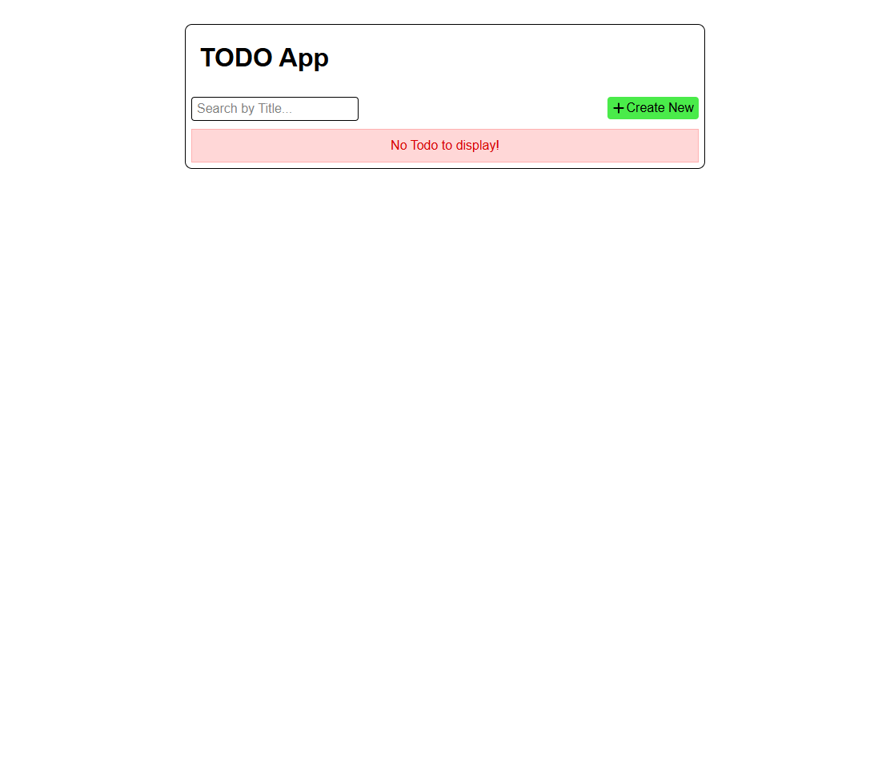

# MERN Todo App

A simple **Todo Management Application** built using the MERN Stack. The app allows users to create, view, search, edit, complete, and delete todo items through a React frontend and Express/MongoDB backend.

**Live project:** [MERN Todo App](https://todo-april-2025.onrender.com/)

### NOTE: 
document of this project is in document folder.

## Features

- Create new todos
- View all todos
- Search todos by title
- Edit existing todos
- Mark todos as completed
- Delete todos with confirmation
- Loading and error handling
- Toast notifications for user actions
- REST API for todo operations
- MongoDB database integration
- React Context API for state management
- Responsive frontend interface

## Technologies Used

### Frontend

- React
- React Router
- Context API
- Tailwind CSS
- React Icons
- React Hot Toast

### Backend

- Node.js
- Express.js
- MongoDB
- Mongoose
- dotenv

## Project Structure

```text
todo-april-2025/
│
├── backend/
│   ├── controllers/
│   ├── models/
│   ├── routes/
│   ├── utils/
│   └── index.js
│
├── frontend/
│   └── src/
│       ├── components/
│       ├── context/
│       ├── App.jsx
│       └── main.jsx
│
├── package.json
└── .env
```

## How It Works

The **React frontend** provides the user interface and sends HTTP requests to the backend API.

The **Express.js backend** handles API requests and communicates with **MongoDB** through Mongoose.

The main todo operations are:

- `POST` — Create a todo
- `GET` — Get all todos
- `GET` — Get a single todo
- `PUT` — Edit a todo
- `PUT` — Toggle todo completion
- `DELETE` — Delete a todo

The frontend uses **React Context API** to manage and refresh the todo data across components.

## API Routes

Base URL:

```text
/api/todo
```

| Method | Endpoint               | Purpose           |
| ------ | ---------------------- | ----------------- |
| POST   | `/create-todo`         | Create a todo     |
| GET    | `/get-all-todos`       | Get all todos     |
| GET    | `/get-todo/:todoId`    | Get one todo      |
| PUT    | `/edit-todo/:todoId`   | Update a todo     |
| PUT    | `/toggleTodo/:todoId`  | Toggle completion |
| DELETE | `/delete-todo/:todoId` | Delete a todo     |
| GET    | `/search-todo`         | Search todos      |
| GET    | `/test`                | Test API          |

## Database

The application uses MongoDB with a Todo model containing:

```text
title
description
complete
createdAt
updatedAt
```

The `title` field is required and unique, while `complete` defaults to `false`.

## Environment Variables

Create a `.env` file in the project root:

```env
MONGO=your_mongodb_connection_string
PORT=3000
```

## Installation

Clone the project and install the dependencies:

```bash
npm install
cd frontend
npm install
cd ..
```

Start the application in development mode:

```bash
npm run dev
```

For production:

```bash
npm run build
npm start
```

## Purpose

This project is designed to demonstrate how a **MERN Stack application** works by connecting a React frontend with an Express/Node.js REST API and MongoDB database.

It is useful for learning **CRUD operations, REST APIs, React state management, routing, database integration, and full-stack application development**.

## Future Improvements

- User authentication and authorization
- Todo categories and priorities
- Due dates and reminders
- Pagination
- Better search and filtering
- Improved form validation
- Automated testing
- Deployment and production optimization

---

# Home Page View



- More images are in **Preview** folder.
